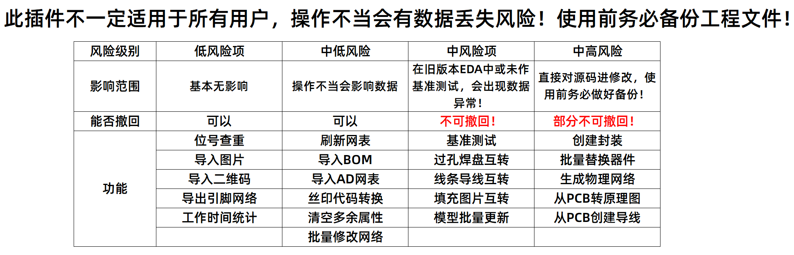

# 狼黑工具 (WolfBlack Tool)

> 嘉立创 EDA 专业版的辅助扩展：把画板时反复出现的琐碎操作，做成点一下就能用的功能。共 23 项，开源免费。
>
> 本工具为非官方第三方开源扩展，与嘉立创 / EasyEDA 官方无隶属关系。

适用的 EDA 版本：**V2.2.45 ~ V4**

---

## 目录

- [这是什么](#这是什么)
- [安装](#安装)
- [装完先做一件事](#装完先做一件事)
- [功能清单](#功能清单)
- [PCB 上的功能](#pcb-上的功能)
- [原理图与符号](#原理图与符号)
- [通用](#通用)
- [快捷键](#快捷键)
- [常见问题](#常见问题)
- [数据安全与隐私](#数据安全与隐私)
- [反馈与支持](#反馈与支持)

---

## 这是什么

画一块板，总有大量重复动作：把说明图贴进丝印、为几十个引脚改网络名、把一整批器件换成新料号、接手别人的板子要反推原理图、想知道这个项目到底花了多少时间。

狼黑工具把这些动作各做成一个页面：打开、粘贴或框选、点一下，结果直接落在当前工程里。

功能全部在本机运行，不上传工程数据。

---

## 安装

### V3 / V4（推荐）

**离线安装（用下载到的 .eext 文件）**

1. 菜单栏「高级 → 扩展管理器」；
2. 点「导入」，选择下载好的 `.eext` 文件；
3. 在扩展列表里找到「狼黑工具」，点「配置」；
4. 勾选 **允许外部交互** 与 **显示在顶部菜单**。

> 第 4 步很关键。不勾「显示在顶部菜单」，装完是看不到菜单的。

**在线安装**

菜单栏「高级 → 扩展管理器」，搜索「狼黑工具」，点「安装」，再按上面第 3、4 步配置。

### V2.2.45

1. 菜单栏「设置 → 扩展 → 扩展管理器 → 导入扩展」；
2. 选择 `.eext` 文件；
3. 装好后同样建议勾选「显示在顶部菜单」。

> V2.2.45 不支持快捷键，也没有部分新功能。新项目建议直接升到 V3 / V4。

---

## 装完先做一件事

**新建一个空白 PCB，运行一次「基准测试」**。

不同版本的 EDA 在坐标和尺寸上存在细微差异。基准测试会让插件在画布上放几个测试图形、读回它们的实际位置，据此算出一组补偿值。校准一次之后，转换图元这类操作的位置会更准。

做法：打开空白 PCB →「狼黑工具 → 转换 → 基准测试」→ 点「创建」→ 全选刚生成的图形 → 点「获取」→ 点「校准」→ 点「保存」。

不做也能用，只是坐标可能会10倍偏移。

---

## 功能清单

| 功能            | 一句话说明                                     | 在哪用       | EDA 版本    | 演示                                               |
| :-------------- | :--------------------------------------------- | :----------- | :---------- | :------------------------------------------------- |
| 基准测试        | 校准插件在新版 EDA 上的坐标与尺寸偏差          | PCB          | V2.2.45 ~ 4    | [打开](https://www.jlc-bbs.com/platform/a/1447593) |
| 导入图片        | 导入 PNG / JPG 图片，尺寸按毫米或 DPI 精确控制 | PCB          | V2.2.45 ~ 4    | [打开](https://www.jlc-bbs.com/platform/a/1220989) |
| 导入二维码      | 在 PCB 上生成二维码，支持多种码制与矢量输出    | PCB          | V2.2.45 ~ 4    | [打开](https://www.jlc-bbs.com/platform/a/1221020) |
| 工作时间统计    | 自动记录每天画板时长，按工程、周、时段出图表   | PCB / 原理图 | V2.2.45 ~ 4    | [打开](https://www.jlc-bbs.com/platform/a/1221046) |
| 焊盘 ⇄ 过孔     | 通孔焊盘和过孔互相转换，尺寸与阻焊保持不变     | PCB          | V2.2.45 ~ 4    | [打开](https://www.jlc-bbs.com/platform/a/1221301) |
| 导线 ⇄ 线条     | 带电的导线和不带电的线条互相转换               | PCB          | V2.2.45 ~ 4    | [打开](https://www.jlc-bbs.com/platform/a/1221325) |
| 填充 ⇄ 图片     | 填充区域和图片对象互相转换，转换后能自由缩放   | PCB          | V2.2.45 ~ 4    | [打开](https://www.jlc-bbs.com/platform/a/1447607) |
| 创建封装        | 把画布上散着的图元打包成一个封装存进个人库     | PCB          | **仅 V2.2.45** | [打开](https://www.jlc-bbs.com/platform/a/1221362) |
| 位号查重        | 找出 PCB 里重复的位号，点一下直接跳过去        | PCB          | V2.2.45 ~ 4    | [打开](https://www.jlc-bbs.com/platform/a/1221381) |
| 生成物理网络    | 没有原理图也能按铜皮接触关系反推出整板网络     | PCB          | V2.2.45 ~ 4    | [打开](https://www.jlc-bbs.com/platform/a/1221422) |
| 导入 AD 网表    | 把 Altium Designer 的网表导入当前 PCB          | PCB          | V2.2.45 ~ 4    | [打开](https://www.jlc-bbs.com/platform/a/1230646) |
| 导出引脚网络    | 把器件引脚与网络的对应关系导出成表格           | PCB          | V2.2.45 ~ 4    | [打开](https://www.jlc-bbs.com/platform/a/1447636) |
| 批量修改网络    | 用 Excel 两列数据批量改名，还能反查引脚        | PCB          | V2.2.45 ~ 4    | [打开](https://www.jlc-bbs.com/platform/a/1221464) |
| 丝印代码转换    | 把 01C 这类丝印代码换算成 10kΩ 并写回          | PCB / 原理图 | V2.2.45 ~ 4    | [打开](https://www.jlc-bbs.com/platform/a/1221485) |
| 清空多余属性    | 一键清掉供应商编号这类用不上的器件属性         | PCB / 原理图 | V2.2.45 ~ 4    | [打开](https://www.jlc-bbs.com/platform/a/1221495) |
| 刷新网表        | 重新读一遍网表再写回，清掉属性里的占位符       | PCB / 原理图 | V2.2.45 ~ 4    | [打开](https://www.jlc-bbs.com/platform/a/1447654) |
| 导入 BOM        | 从 Excel 粘贴 BOM，批量回填器件参数            | PCB / 原理图 | V2.2.45 ~ 4    | [打开](https://www.jlc-bbs.com/platform/a/1221515) |
| 批量替换器件    | 按位号批量换成立创器件，位置角度不变           | PCB          | V2.2.45 ~ 4    | [打开](https://www.jlc-bbs.com/platform/a/1221533) |
| 模型批量更新    | 批量调整模型大小角度位置，或从旧网表恢复模型   | PCB          | V2.2.45 ~ 4    | [打开](https://www.jlc-bbs.com/platform/a/1221572) |
| 从 PCB 转原理图 | 拿 PCB 上的器件和位置，反向生成一张原理图      | 原理图       | V2.2.45 ~ 4    | [打开](https://www.jlc-bbs.com/platform/a/1221620) |
| 创建导线        | 按 PCB 或网表给原理图里缺失的引脚补导线        | 原理图       | V2.2.45 ~ 4    | [打开](https://www.jlc-bbs.com/platform/a/1221655) |
| 引脚排序        | 给符号引脚按编号或名称排序，可设间距           | 符号         | V2.2.45 ~ 4    | —                                                  |
| EDA 桥          | 让外部程序把图形送进画布，也可作为调试通道     | 通用         | V2.2.45 ~ 4    | —                                                  |

---

## 功能说明

### 基准测试

**校准插件在个别 EDA 版本上的坐标与尺寸偏差**

1. 新建并打开一个空白 PCB 文档；
2. 菜单「狼黑工具 → 转换 → 基准测试」，点「创建」，画布上会生成一组测试图元；
3. 全选刚生成的图元，点「获取」，读回它们的实际坐标；
4. 点「校准」自动算出补偿值，确认无误后点「保存」。

> 刚装好插件或升级 EDA 之后建议先做一次。不做也能用，只是坐标可能会10倍偏移。

### 导入图片

**导入 PNG / JPG 图片，尺寸按毫米或 DPI 精确控制**

1. 菜单「导入 → 图片」，点「选择图片」，可以一次选多张；
2. 设置宽高（默认锁定比例），或从 300 / 600 / 900 / 1200 / 2400 / 4800 DPI 里选一档；
3. 图片很大时勾选「切片导入」，绕过单个图元的大小限制；
4. 选好放置图层，点「放置」，鼠标移到画布上单击即可落位。

> 切片导入后需要手动全选切片再「组合」；选了多张图会依次放置。

### 导入二维码

**在 PCB 上生成二维码，支持多种码制与矢量输出**

1. 在「数据内容」里输入要编码的文字或网址；
2. 选码类型、容错级别、物理尺寸和前后景色；
3. 点「重新生成」预览效果，「保存图片」可单独导出；
4. 直接单击预览里的码，就能把它放到画布上。

> 矢量码放大后依然清晰，适合做丝印；位图码数据量小，看用途选择。

### 焊盘 ⇄ 过孔

**通孔焊盘和过孔互相转换，尺寸与阻焊保持不变**

1. 在 PCB 上框选或点选要转换的过孔 / 通孔焊盘；
2. 菜单「转换 → 焊盘 ⇄ 过孔」；
3. 所选对象原地转换，坐标、孔径、阻焊扩展都不变。

> 过孔转成通孔焊盘后，可以单独设置内层铜环，也能被「禁止铺铜」约束管住。

### 导线 ⇄ 线条

**带电的导线和不带电的线条互相转换**

1. 选中导线或线条；
2. 菜单「转换 → 导线 ⇄ 线条」；
3. 多段首尾相接的导线会合并成一条连续折线。

> 转换失败会自动还原原对象，不会出现两头都丢掉的情况。

### 填充 ⇄ 图片

**填充区域和图片对象互相转换，转换后能自由缩放**

1. 选中填充区域，或插件生成的图片对象；
2. 菜单「转换 → 填充 ⇄ 图片」；
3. 转成图片后可用控制柄拉伸缩放；转回填充后可继续编辑轮廓。

> 二维码这类复杂轮廓也能转，但图元数量会比较多，大图转换需要等几秒。

### 创建封装

**把画布上散着的图元打包成一个封装存进个人库**

1. 用焊盘、丝印等图元在 PCB 上画好封装外形；
2. 框选全部组成图元；
3. 菜单「器件 → 创建封装」，选存放的库，填名称与位号；
4. 点「创建封装」，完成后封装会出现在个人库里。

> **仅支持 V2.2.45**。V3 / V4 缺少可用的封装写入能力，这个功能用不了，请改用官方封装编辑器。

### 位号查重

**找出 PCB 里重复的位号，点一下直接跳过去**

1. 菜单「器件 → 位号查重」；
2. 有重复时，结果会列在日志面板里；
3. 点日志条目，视角自动跳过去并高亮对应器件。

> 批量替换器件、导入 BOM 之前建议先查一次，位号重复会让结果对不上。

### 生成物理网络

**没有原理图也能按铜皮接触关系反推出整板网络**

1. 菜单「网络 → 生成物理网络」；
2. 点「计算拓扑」，等待分析完成（大板会久一些）；
3. 选择写入方式：网表 / 源码 / API；
4. 点「写入」，把结果应用到当前 PCB。

> 纯几何判断有容错率，拓扑特别复杂时建议改用「导入 AD 网表」。V4 上写入后可能需要重新铺一次铜。

### 导入 AD 网表

**把 Altium Designer 的网表导入当前 PCB**

1. 在 Altium Designer 里导出 .net 网表；
2. 菜单「网络 → 导入 AD 网表」，用「选择文件」或「粘贴网表」载入；
3. 核对新旧网络的对比结果；
4. 点「写入网表」应用。

> 导入前先确认没有重复位号，并重置元件唯一 ID，否则可能对不上。

### 导出引脚网络

**把器件引脚与网络的对应关系导出成表格**

1. 框选要导出的器件；
2. 菜单「网络 → 导出引脚网络」；
3. 「导出引脚网络」只导所选器件，「导出全部网络」导整板；
4. 保存后用 Excel 打开。

> 阵列式器件（驱动器、继电器）批量改网络名时，配合 Excel 自动填充最快。

### 批量修改网络

**用 Excel 两列数据批量改名，还能反查引脚**

1. 在 Excel 准备两列：旧网络名、新网络名；
2. 复制这两列，粘贴到插件里；
3. 需要全大写时勾选「转大写」；
4. 点「执行替换」；下方「查询引脚」可以按网络名反查引脚。

> 匹配网络名时不区分大小写。替换前建议先「导出引脚网络」留一份对照。

### 批量替换器件

**按位号批量换成立创器件，位置角度不变**

1. 在 Excel 准备两列：位号、立创 C 编号，复制；
2. 菜单「器件 → 批量替换器件」，点「粘贴」；
3. 点「获取」，拉取新器件的参数；
4. 点「替换」，等待进度条走完。

> 使用前务必备份，并确保位号不重复。V2.2.45 上需要按提示手动选中临时器件取参数。

### 模型批量更新

**批量调整模型大小角度位置，或从旧网表恢复模型**

1. 菜单「器件 → 模型批量更新」；
2. 要恢复模型时，「读取网表」选早期备份的工程文件；只调参数时点「获取当前数据」；
3. 调大小、旋转角度和各方向偏移，可切换单位；
4. 点「执行更新」。

> 3D 模型意外丢失时，用早期备份的网表通常能恢复回来。

### 丝印代码转换

**把 01C 这类丝印代码换算成 10kΩ 并写回**

1. 菜单「器件 → 丝印代码转换」；
2. 面板自动列出 C / R / L 开头的器件，并给出换算后的值；
3. 「转换值」可以直接改，改完这一行会自动勾上「修改」；
4. 确认勾选后点「执行」，按表里的值写回器件名称。

> 换算值以 Ω / pF / uH 为单位；认不出的代码会原样留在表里，改文本框就能手动纠正。

### 清空多余属性

**一键清掉供应商编号这类用不上的器件属性**

1. 菜单「器件 → 清空多余属性」，先点「刷新数据」；
2. 在基础属性 / 关键属性 / 更多属性里勾选要保留的项；
3. 点「执行清空」。

> 借用别人的封装时最有用，可以去掉原器件带来的供应商编号等信息。

### 刷新网表

**重新读一遍网表再写回，清掉属性里的占位符**

1. 菜单「器件 → 刷新网表」；
2. 插件自动读取网表并重新写入；
3. 核对预览结果，确认后应用。

> 属性值里出现大量 ={Value} 字样时用它。

### 导入 BOM

**从 Excel 粘贴 BOM，批量回填器件参数**

1. 在 Excel 里整理好数据，第一行写列名，其中必须有「位号」；
2. 复制整块数据，在插件里点「粘贴」；
3. 把表格列对应到「立创编号」「供应商」等字段；
4. 点「导入」，参数会写回图纸。

> 表格必须用制表符分隔（直接从 Excel 复制即可）；位号要与画布完全一致。

### 从 PCB 转原理图

**拿 PCB 上的器件和位置，反向生成一张原理图**

1. 新建一个已绑定目标 PCB 的空白原理图，并切到原理图页；
2. 菜单「从 PCB 转原理图」，点「加载数据」；
3. 选分类方式，必要时用「匹配符号」「指定符号」修正个别器件；
4. 点「构建源码」，核对无误后点「写入文档」；
5. 需要留档时可用「导出表格」「导出网络」。

> 写入前请保持在原理图页。写完会清点器件数，为 0 时会明确提示，不会假报成功。

### 创建导线

**按 PCB 或网表给原理图里缺失的引脚补导线**

菜单「创建导线」下五个入口：

| 入口 | 做什么 |
| :--- | :----- |
| 来自PCB | 按 PCB 上**选中的器件**补导线（需要 PCB 已打开） |
| 来自网表 | 按**网表缓存**补导线，不依赖 PCB 是否打开 |
| 从PCB更新网表缓存 | 自动切到 PCB 取整块板的 `.enet` 网表，存进缓存后切回原理图 |
| 从文件更新网表缓存 | 弹文件框选一个 `.enet`，存进缓存（不动当前文档） |
| 清空网表缓存 | 把缓存里的网表清掉 |

1. 先把网表存进缓存：菜单「创建导线 → 从PCB更新网表缓存」，或用「从文件更新网表缓存」选一个 `.enet`；
2. 在原理图里选中要补线的器件；
3. 点「创建导线 → 来自网表」，插件按缓存里的网络给缺失的引脚画上带网络名的短线；想按 PCB 上选中的器件补，就用「来自PCB」。

> 两个来源的缓存**只存一份**，后更新的覆盖前一份。「从PCB更新网表缓存」跑完会自动切回原理图，不用手动切。「来自PCB」需要 PCB 已打开（左右分屏会导致取不到数据），一般配合「从 PCB 转原理图」使用：先出符号，再补导线。

### 引脚排序

**给符号引脚按编号或名称排序，可设间距**

1. 打开符号编辑器，选中要排序的引脚；
2. 菜单「引脚排序」；
3. 选按编号或名称、升序或降序，设置间距与末尾排序方式；
4. 点「升序」或「降序」执行。

> 只对选中的引脚生效，没选中的不会动。

### 工作时间统计

**自动记录每天画板时长，按工程、周、时段出图表**

1. 插件在后台自动计时，不需要手动开始或结束；
2. 菜单「工作时间统计」打开面板；
3. 顶部切换「总览 / 周报 / 节律 / 工程管理」，看不同维度的数据；
4. 「导出图表」存当前图，「导出总趋势图表」存全量趋势，「导出备份数据」备份原始记录；
5. 换电脑或重装后，在「更多选项 → 导入数据」选回那个备份文件即可恢复；面板顶部还会显示当前账号与累计工时。

> 记录只存在本机，不会上传。换电脑或重装前请先「导出备份数据」。备份带账号信息与签名：只能导入自己账号导出的备份，用文本编辑器改过数字的文件会被拒绝；导入只补全不覆盖，重复导入不会翻倍。

### EDA 桥

**让外部程序把图形送进画布，也可作为调试通道**

1. 在电脑上启动配套的桥服务（仓库 `tools/eda-bridge` 内提供）；
2. 打开「EDA 桥」页面，确认地址为 `127.0.0.1:8233`，点「连接」；
3. 外部程序即可通过桥把识别好的图形（例如从图片识别出的导线、焊盘）送进当前画布；
4. 需要远程执行调试指令时，由桥服务直接下发（页面上不再另设开关）。

> 这是开发者自测通道：连上后允许在 EDA 里执行代码，请只在本地可信环境使用。

---

## 快捷键

| 快捷键         | 功能        |
| :------------- | :---------- |
| `Ctrl+Shift+C` | 导入图片    |
| `Ctrl+Shift+G` | 焊盘 ⇄ 过孔 |
| `Ctrl+Shift+X` | 导线 ⇄ 线条 |
| `Ctrl+Shift+F` | 填充 ⇄ 图片 |
| `Ctrl+Alt+W`   | 位号查重    |

> 快捷键需要 EDA V3 及以上；V2.2.45 不支持。

---

## 常见问题

**装好了，但菜单栏里没有「狼黑工具」**  
在扩展管理器里点「配置」，勾选「显示在顶部菜单」，然后重启 EDA。

**点了菜单没反应，或者提示请切换到某个页面**  
多数功能只对特定文档生效：PCB 功能要在 PCB 页，原理图功能要在原理图页。先切到对应页面再执行。

**升级 EDA 之后，图形位置有点偏**  
重新跑一次「基准测试」并保存校准值。

**V2.2.45 上某个功能报错**  
V2.2.45 官方已停止维护，其底层能力缺失较多。除「创建封装」外的功能都建议在 V3 / V4 上使用。

**批量替换器件提示找不到器件**  
先检查位号有没有重复（用「位号查重」），再确认粘贴的 C 编号真实存在。操作前务必备份工程。

**生成网络或转原理图之后，铜皮看起来没了**  
V4 上整份重写后，已算好的铜皮填充需要重新计算一次：重新铺铜即可，数据本身没丢。

**导出的工时报告在别人电脑上打不开图表**  
v1.20.0 起报告已内置图表库，断网也能看。如果是旧版本导出的报告，升级后重新导出一次。

**工时数据换电脑会丢吗**  
会。记录只在本机，换电脑前用「导出备份数据」备份；在新电脑上打开「更多选项」→「导入数据」，选回那个文件即可恢复。

**导入同事给的工时备份，提示「不能导入别人的数据」**  
这是有意为之。备份里带导出者的账号信息并用它签名，只有同一账号才能导入；换账号、改过文件都会失败。需要合并别人的数据请让对方在你自己的账号下重新导出。

---

## 数据安全与隐私

- 所有工程数据都在你的电脑上处理，**不上传**。
- 工时记录、校准参数保存在本机扩展存储里；卸载扩展或点「清除数据」后不可恢复。
- 「导出备份数据」生成的备份里会写入你的账号信息（用户名、昵称、账号 id），用于导入时校验归属；文件只存到你选择的位置，不会上传。
- 会联网的只有两处：批量替换器件、按 C 编号取器件参数时向立创商城查询该器件信息；工时统计的「更多选项」显示头像时向嘉立创头像 CDN 取你自己的头像图片。
- 会改写工程的功能（生成物理网络、批量替换器件、从 PCB 转原理图等），**执行前请先备份工程**。

完整说明见 [PRIVACY.md](PRIVACY.md)。

---

## 反馈与支持

- 问题与建议：[GitHub Issues](https://github.com/WOLF4096/easyeda_wolfblack_tool/issues)
- 更新日志：[CHANGELOG.md](CHANGELOG.md)
- 扩展主页：[嘉立创 EDA 扩展广场](https://ext.lceda.cn/item/darksteel/wolfblack-tool)

---

## 免责声明

本扩展按「现状」免费提供。它源于实际工作中的需求，并非经过完整商业化测试的通用产品。EDA 各版本行为存在差异，建议先在测试工程上验证效果。开发者不对因使用本插件导致的工程损坏、数据丢失或生产损失承担连带责任。开始使用即表示你已知晓并自担风险。

---

## 开发与构建

二次开发、构建与测试请看 [README.dev.md](README.dev.md)。

---

> 开发者：WOLF4096  
> 辅助开发：DeepSeek-V4.1-Flash  
> 本工具为非官方第三方开源扩展，与嘉立创 / EasyEDA 官方无隶属关系
