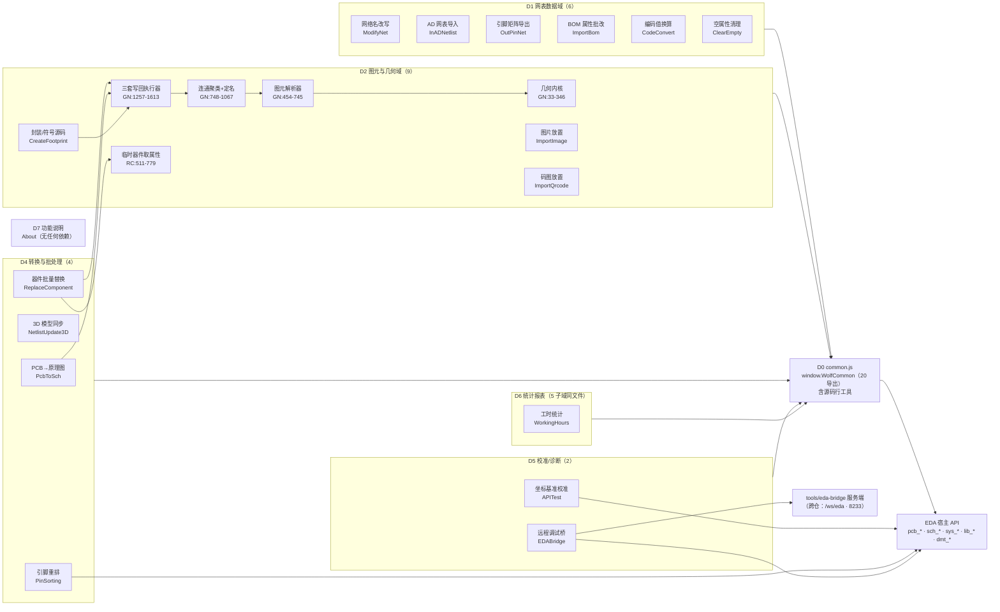

# iframe/js/app 模块分析报告（按业务域）

范围：`iframe/js/app/*.js` 共 18 个文件、约 12 940 行。
方法：全量通读 + 交叉引用检索。**结论均为只读分析，未改动任何文件。**

---

## 0. 前置事实（先纠正三个常见误解）

| 常见假设 | 实际情况（已验证） |
|---|---|
| 这些文件是 ESM / IIFE 模块 | 只有 `InADNetlist.js`、`ModifyNet.js` 用 `(function(){…})()` 包裹；**其余 16 个是顶层裸脚本**，`const WC` / `let zip` 直接落在脚本全局词法作用域，`function` 声明挂到 `window`。 |
| 文件之间有 import/require 依赖 | **一条都没有**。全量检索 `xxx.js` / `import(` / `getScript` 命中 0。每个页面 HTML = `common.js` + 一个 app 脚本。 |
| 已按"模块"组织 | 组织单位是**页面**，不是模块。除 `common.js` 外全部无导出，靠加载顺序 + 副作用执行；只有 `APITest` / `WorkingHours` 通过 inline `onclick` 暴露全局函数。 |

由此得到本报告的基本判断：

1. **显式依赖是星型的**：18 个页面模块 → `common.js` → 宿主 `eda` API。模块化只做到了"文件隔离"，没有依赖管理。
2. **隐式耦合比显式依赖严重得多**：同一份知识（源码行格式、引脚双结构、版本判定、图层映射）在多处各自实现 2~5 份，改一处必然漂移。
3. **按业务域切分后，"域"与"文件"是错位的**：`GenerateNet.js` 一个文件横跨几何域 / 解析域 / 网表域 / UI 域四种域；而"源码行读写"这一域横跨 5 个文件。

---

## 1. 模块清单（业务域视角）

> 「对外导出」一列的 `—` 表示该模块无任何导出，只在页面加载时执行副作用。
> 「依赖」一列：`D0` = `common.js`；`#n` = 本表第 n 号模块；`eda.x` = 直接调用的宿主 API。

### D0 平台底座

| 业务域 | 模块 | 所在文件:行段 | 职责一句话 | 对外导出 | 依赖 |
|---|---|---|---|---|---|
| D0 平台 | 公共运行时底座 | `common.js:17-518` | 宿主句柄、版本能力、图层常量、网表读写、源码行工具、日志与转义 | `window.WolfCommon`（20 项，`:494-517`） | `eda` |

> `common.js` 自身还有 6 个子域可再分：宿主适配（`getEda/hasEda`）、能力判定（`isV2/V3/V4/isModern/isInnerLayer…`）、常量（`LAYER/NETLIST_KEY`）、网表 IO（`getNetlist/setNetlist/getComponentsContainer`）、源码行工具（`splitSourceLine/joinSourceLine/toApiLength`）、发射与日志（`createSchWireLines/logger/escapeHtml`）。

### D1 网表数据域（读 → 改 → 写 PCB 网表）

| 业务域 | 模块 | 所在文件:行段 | 职责一句话 | 对外导出 | 依赖 |
|---|---|---|---|---|---|
| D1 网表 | **网表容器与引脚访问**（缺失的模块） | 无独立文件，分散 5 处 | 领取 `components` 容器、读写某引脚网络——全项目最基础的能力，却只有"容器"进了 D0 | 部分（`WC.getComponentsContainer`），引脚访问器缺失 | D0 |
| D1 网表 | 网络名批量改写 | `ModifyNet.js:1-215` | 粘贴 TSV 旧名→新名，逐器件改网络名后整份写回 | — | D0、#2 |
| D1 网表 | AD 网表导入 | `InADNetlist.js:1-434` | 解析 AD `.NET` 括号块 → `位号\|引脚→网络` → 对比表 → 覆写网表 | — | D0（未用 `getComponentsContainer`，自写两份容器探测） |
| D1 网表 | 引脚-网络矩阵导出 | `OutPinNet.js:1-336` | 网表摊成"器件×引脚"矩阵并导出 CSV，附网络长度 | — | D0、`eda.pcb_Net` |
| D1 网表 | BOM 属性批改 | `ImportBom.js:1-496` | 提取 BOM 六列，粘贴 Excel 批量改后写回网表 | — | D0 |
| D1 网表 | 元件编码值换算 | `CodeConvert.js:1-760` | R/C/L 编码（`01C`/`104`/`4R7`）→ 带单位值，写回 `Name`/`Value` | —（12 个纯换算函数未导出，无法单测） | D0 |
| D1 网表 | 空属性清理 | `ClearEmptyProperties.js:1-301` | 按分类把器件空属性/全部属性置空并写回 | — | D0（绕过 `WC.getEda`，自写 `notice`） |

### D2 PCB 图元与几何域

| 业务域 | 模块 | 所在文件:行段 | 职责一句话 | 对外导出 | 依赖 |
|---|---|---|---|---|---|
| D2 图元 | 几何内核 | `GenerateNet.js:33-346` | 线段/矩形/多边形/圆弧碰撞判定、圆弧离散、并查集 | — | 无（零依赖，全项目最该独立的一块） |
| D2 图元 | PCB 图元解析器 | `GenerateNet.js:454-745` | V2 数组源码 / V3V4 日志源码 → 统一图元结构 | — | #9、D0 `splitSourceLine` |
| D2 图元 | 连通性聚类 | `GenerateNet.js:748-841` | 空间网格 + 两两碰撞 + 并查集 → 连通块，并回填引脚信息 | — | #9、#10 |
| D2 图元 | 网络定名 | `GenerateNet.js:917-958`、`1011-1051` | 连通块内投票选网络名，通用名分配 `NETn` | —（**同一逻辑两份**） | #11 |
| D2 图元 | 物理网络写回 | `GenerateNet.js:1257-1613` | 三条执行器：网表对象 / 文档源码 / 图元 API | — | #12、#18、D0 |
| D2 图元 | 图片放置 | `ImportImage.js:1-876` | 读图 → DPI 算物理尺寸 → 切片 → 建 `Object` 图元 → 鼠标跟随落地 | — | D0 `toApiLength`、`eda.pcb_Object/SelectControl` |
| D2 图元 | 码图放置 | `ImportQrcode.js:1-544` | bwip-js 生成条码/二维码 → 位图或矢量图元 → 跟随放置 | — | D0、`eda`、`bwip-js` |
| D2 图元 | 临时器件取属性 | `ReplaceComponent.js:511-779` | 把目标器件放到 `(-10000,-10000)` 读真实属性（或等用户框选）后清理 | — | #23、`eda.lib_Device/pcb_Component` |
| D2 图元 | 封装与符号源码生成 | `CreateFootprint.js:59-492` | 选中图元 → 原点归零 → 拼封装源码 + 符号源码 → 建库 → 放器件 → 删原图元 | — | #18、`eda.lib_*` |

### D3 文档源码域（唯一横跨多文件的域）

| 业务域 | 模块 | 所在文件:行段 | 职责一句话 | 对外导出 | 依赖 |
|---|---|---|---|---|---|
| D3 源码 | 源码行工具 | `common.js:440-492` | 单行拆分/合并、保留行尾 `\|`、长度转 API 数字 | `WC.splitSourceLine` / `joinSourceLine` / `toApiLength` | 无 |
| D3 源码 | PCB 源码行改写 | `ReplaceComponent.js:884-976`；`GenerateNet.js:1385-1541`；`APITest.js:257-357` | 按 id 定位行、改字段、原样写回 | — | #18（`ReplaceComponent` 手写了一份 split/join，`APITest` 又自造了一套 V2/V3 探测） |
| D3 源码 | 原理图源码发射 | `PcbToSch.js:954-1541`；`CreateFootprint.js:237-436` | 生成 COMPONENT / ATTR / TEXT / 头部 / LAYER 行（V2 与 V4 两套字段顺序） | —（只有导线走 `WC.createSchWireLines`） | #18、D0 |

### D4 转换与批处理域

| 业务域 | 模块 | 所在文件:行段 | 职责一句话 | 对外导出 | 依赖 |
|---|---|---|---|---|---|
| D4 转换 | PCB→原理图 | `PcbToSch.js:1-1541` | 解包 `.epro` → 反查 PCB → 解析元件/符号引脚 → 布局 → 生成原理图 → 预览/写回/另存 | — | #18、#20、`JSZip`、`eda` |
| D4 转换 | 3D 模型同步 | `NetlistUpdate3DModels.js:1-391` | 读网表 3D 属性 → 表格改 9 参数（mm/mil）→ 逐器件 `modify` + 回读校验 | —（`window.updateParam`） | D0、`eda.pcb_PrimitiveComponent` |
| D4 转换 | 器件批量替换 | `ReplaceComponent.js:1-1174` | 位号+立创编号 → 改器件/封装/3D/网表，两处器件引用同步 | — | #16、#19、D0 |
| D4 转换 | 引脚重排 | `PinSorting.js:1-114` | 轮询选中引脚 → 自然序/末尾序排序 → 按首脚朝向重排坐标 | —（`applySort`） | `eda.sch_SelectControl/sch_PrimitivePin`（**完全不用 D0**） |

### D5 校准 / 诊断域

| 业务域 | 模块 | 所在文件:行段 | 职责一句话 | 对外导出 | 依赖 |
|---|---|---|---|---|---|
| D5 诊断 | 坐标基准校准 | `APITest.js:1-605` | 建/取 5 类图元 → 比对源码值与 API 值 → 推补偿系数 → 持久化 | —（inline：`executeBatch`/`autoCalibrateAll`/`saveParams`） | `eda`（自造 V2/V3 解析，绕开 D0） |
| D5 诊断 | 远程调试桥 | `EDABridge.js:1-413` | WebSocket 客户端：`ping`/`import`/`probe`/`eval` + 选中对象采样上报 | —（把 `WolfCommon` 注入 eval 沙箱） | `tools/eda-bridge` 服务端（跨仓协议）、`eda` |

### D6 统计报表域 / D7 内容域

| 业务域 | 模块 | 所在文件:行段 | 职责一句话 | 对外导出 | 依赖 |
|---|---|---|---|---|---|
| D6 统计 | 工时数据读取与聚合 | `WorkingHours.js:126-257` | 读扩展配置里的 15min 切片 → 补洞成连续时间轴 → 聚合 | — | `eda.sys_Storage/dmt_Project`、D0 `escapeHtml` |
| D6 统计 | 工时图表 | `WorkingHours.js:359-1004` | 6 个 ECharts 实例（主图/单工程/热力/节律/周柱/周饼） | — | #26 |
| D6 统计 | 报告导出 | `WorkingHours.js:1116-1596` | GZIP+SHA256 自校验 HTML 报告（内嵌 343 行"另一个页面"）、JSON 备份、周报 PNG | — | #26、#27、`fflate` |
| D6 统计 | 施工提醒规则 | `WorkingHours.js:1685-1842` | **与工时无关**的时限提醒 CRUD | —（`window.ReminderApp`） | `eda.sys_Storage` |
| D6 统计 | 工程管理 | `WorkingHours.js:1009-1085`、`1601-1680` | 工程表排序、按工程删除/全量清空 | — | #26 |
| D7 内容 | 功能说明页 | `About.js:1-367` | 22 条功能文案（硬编码）+ 手风琴表格 + 图片浮窗 | — | **无**（连 D0 都不引用） |

---

## 2. 模块依赖关系

### 2.1 显式依赖（事实）



### 2.2 依赖树（文字版）

```
eda（宿主）
└── D0 common.js ── window.WolfCommon（20 导出）  ← 唯一被复用的节点
    ├── D1 网表域
    │   ├── ModifyNet（网络名改写）
    │   ├── InADNetlist（AD 导入）── 未用 getComponentsContainer，自写容器探测 ×2
    │   ├── OutPinNet（引脚矩阵）── 直调 eda.pcb_Net
    │   ├── ImportBom（BOM 属性）
    │   ├── CodeConvert（编码换算）── 12 个纯函数留在页面里
    │   └── ClearEmptyProperties ── 绕过 WC.getEda，自写 notice
    ├── D2 图元与几何域
    │   ├── GenerateNet（一个文件 = 4 个域：几何 → 解析 → 聚类定名 → 三套写回）
    │   ├── ImportImage / ImportQrcode（各自一套跟随放置）
    │   ├── ReplaceComponent ──→ 临时器件取属性 → 源码改写 → 3D/网表
    │   └── CreateFootprint ──→ 封装源码 + 符号源码（自建 15 行 LAYER 表）
    ├── D4 转换与批处理
    │   ├── PcbToSch（+ JSZip，跨 5 个阶段，自带布局引擎与发射器）
    │   ├── NetlistUpdate3DModels
    │   ├── ReplaceComponent（同上，跨 D2/D3）
    │   └── PinSorting ── 完全不用 D0，裸调 eda
    ├── D5 校准/诊断
    │   ├── APITest ── 自造 V2/V3 探测，绕开 D0
    │   └── EDABridge ──→ tools/eda-bridge（跨仓协议：路径/端口/指令名/字段名）
    ├── D6 WorkingHours（5 个子域挤在一个文件）
    └── D7 About（零依赖，纯静态内容）
```

### 2.3 隐式耦合（真正需要治理的部分）

显式图上没有边，但下列"知识"被重复实现，等于多重隐式依赖：

| 知识 | 重复实现位置 |
|---|---|
| 一行 PCB 源码长什么样 | `GenerateNet`（用 D0）、`ReplaceComponent`（手写 split/join）、`APITest`（自造 `includes('||')`）、`CreateFootprint`（类型→索引表） |
| 一行原理图源码长什么样 | `PcbToSch`（V2 与 V4 各一套字段顺序）、`CreateFootprint`（符号/封装 header）、`common.createSchWireLines`（只有导线收敛了） |
| 网表里引脚存在哪 | `ModifyNet`、`InADNetlist`、`OutPinNet`、`GenerateNet`（各写一次 `pinInfoMap`/`pins` 双分支） |
| 版本 / 数据形状判定 | `D0.isModern`（16 处）、`APITest` 自造、`ModifyNet` 用 `isModern` 当"数据格式"判断（语义错误） |

---

## 3. 多职责文件与拆分建议

| 文件 | 行数 | 职责数 | 承担了什么（证据） | 建议拆分 |
|---|---|---|---|---|
| `GenerateNet.js` | 1680 | **6** | 几何内核(33-346) / 图元解析(454-745) / 聚类定名(748-1067) / 三套写回(1257-1613) / 表格与进度 UI(1070-1215) / 编排(1621-1680) | `geometry.js`←33-346、`pcbSourceParser.js`←454-745、`connectivity.js`←748-841、`netNamer.js`←917-1051、`writers/{netlist,source,api}.js`←1267-1613；页面只留 UI + 编排。解析/聚类层里的 12 处 `updateFooterStatus` 改成 `onProgress` 回调 |
| `WorkingHours.js` | 2195 | **6** | 数据读取(126-257) / 聚合(内联) / 6 个图表(359-1004) / 报告导出含 343 行另一页面(1116-1596) / 工程管理(1009-1085,1601-1680) / 提醒规则 CRUD(1685-1842) | `stats.js`←126-257+1088、`charts.js`←359-1004（`createChart` 工厂 + 注册表）、`report.html`←1247-1589 外置资源、`reminder.js`←1682-1842、`manage.js`←1009-1085+1601-1680 |
| `PcbToSch.js` | 1541 | **7** | zip 解包(136-189,513-569) / project.json 四级反查(572-593) / PCB 解析(595-667) / 符号库索引(814-951) / 布局引擎(1186-1279 ≡ 1423-1509) / 源码发射(1323-1541) / 预览表 + 写入自检(733-768,456-510) | `projectArchive.js`、`pcbToSchModel.js`(572-731 纯)、`symbolIndex.js`(814-951)、`schLayout.js`(两版布局合并为一个纯函数)、`schEmitter.js`(1323-1368，最该补单测) |
| `ReplaceComponent.js` | 1174 | **5** | 取属性(511-779，EDA 副作用) / 数据分组(229-435,844-871) / 源码改写(884-980) / 删临时器件(984) / 3D+网表同步(988-1068) | `fetchProps.js`、`replacePlan.js`(纯)、`sourceRewrite.js`、`postSync.js`；并补一个真正的回滚（现在 `setDocumentSource` 之后失败不回退） |
| `ImportImage.js` | 876 | **5** | 文件读取 / DPI 数学(124-234) / canvas 切片(287-360) / 图元创建+跟随(393-500) / 版式规划(603-708) | `dpi.js`、`tiler.js`、`imageLayoutPlan.js`(纯，最值得单测)、`PlacementController` |
| `ImportQrcode.js` | 544 | 4 | 码生成(226-308) / 图层注册(152-184) / 图元创建(355-379) / 跟随(389-410) | `barcode.js`、`layerRegistry.js`；跟随与 ImportImage 合并 |
| `CreateFootprint.js` | 495 | 4 | 坐标变换(116-187,260-352) / 封装源码(237-359) / 符号源码(392-439) / 放置与删除(442-476) | `sourceBuilder.js`←237-436、`primitiveTransform.js`←260-352；`onRunClick`(59-492, 434 行单函数)按 A~F 阶段拆开 |
| `APITest.js` | 605 | 4 | 图元建/取(176-256) / 源码解析(257-357) / 校准数学(126-464) / 持久化(44-76,527-604) | `calibration.js`(纯)、`sourceProbe.js`（改用 D0 `splitSourceLine`）；4 张字段表合成 1 张 |
| `ModifyNet.js` | 215 | 结构问题 | **0 个具名函数**，全部逻辑塞在 2 个事件回调里 | 抽出 `parseTsv` / `buildReplaceMap` / `applyRenames`（均可单测） |
| `About.js` | 367 | 2 | 244 行硬编码文案 + 手写渲染器 | 文案 → `iframe/data/features.json`；渲染器保留；`usage` 走 `escapeHtml` |
| `PinSorting.js` | 114 | 3 | 轮询(4-15) / 排序算法(32-75) / 几何重排与写入(18-105) | 轮询 → `WC.pollSelection`；`transformKey`/`normalizeRotation` 抽纯模块 |

**拆分时的一条硬约束**：`GenerateNet`、`PcbToSch`、`ReplaceComponent` 的写源码路径都建立在"先删后建 / 先写源码后删临时器件 / V4 不能丢 POURED 行"这些**已在 MEMORY 里固化的平台约束**上，拆文件时必须把这些约束的注释一起搬走，否则后续维护者会按"看起来更合理"的顺序重排而写坏文档。

---

## 4. 重复 / 可复用逻辑清单

按收益排序（同时列出可直接消除的行数规模）。

| # | 能力 | 重复证据 | 建议归属 |
|---|---|---|---|
| 1 | **提示 / toast** | 5 套封装：`ImportImage:70` `showMessage`、`ImportQrcode:311` `showToast`（判断了不存在的 `sys_ToastMessage`）、`CreateFootprint:1` `showMsg`、`ClearEmptyProperties:8` `notice`（DOM 横幅兜底）、`NetlistUpdate3DModels:8` `notice`（同款兜底）；另有 **47 处**裸调 `showToastMessage`，第二参数字/字符串三套约定混用 | `WC.ui.toast(msg, level)`，内置 DOM 降级 |
| 2 | **表格控制器**（排序 / 全选 / 半选 / 列级勾选 / disabled-row） | `ReplaceComponent:54-110,783-831,1152-1163`、`ClearEmptyProperties:128-166,271-296`、`ImportBom`、`CodeConvert`、`OutPinNet`、`NetlistUpdate3DModels`：约 150 行同构代码 | `WC.ui.tableController` |
| 3 | **引脚双结构读写**（`pinInfoMap` / `pins`） | `ModifyNet:79-100`（2×2 四条路径）、`InADNetlist:104-113,272-286`、`OutPinNet:30-42`、`GenerateNet:990-994,1318-1342` | `WC.getPins(comp)` / `WC.setPinNet(comp,pin,net)` |
| 4 | **版本 / 数据形状判定** | `APITest:270-283` 自造 `includes('||')`；`ModifyNet:78,153` 用 `isModern()` 判断网表结构（版本≠格式，会误判）；`PcbToSch` 用 `isV2/isModern` 三处 | D0 增加 `detectNetlistShape()`，禁止用版本推断格式 |
| 5 | **源码行知识** | `ReplaceComponent:920-970` 手写了一遍 `split/join`（D0 已有）；`APITest:257-357` 自造 V2/V3 双解析；`PcbToSch:1323-1368` 自造 COMPONENT/ATTR 发射；`CreateFootprint:240-254` 自建 15 行 LAYER 表 | `sourceCodec`：`parseLine` / `rewriteLine` / `emitComponent` / `emitAttr`（补字节级单测，与 `src/js/common/sourceEmitter.js` 同规格） |
| 6 | **单位与尺寸传递** | `MM_TO_MIL` 常量 3 份；`toFixed→DOM→parseFloat` 往返 `ImportImage` 6 处、`CreateFootprint` 10 处、`ImportQrcode` 4 处；`NetlistUpdate3DModels` 的 `0.0254` 正反各一份 | `WC.unit.{mmToMil,milToMm,readLength,writeLength}`，长度进 API 一律走 `toApiLength` |
| 7 | **图层映射** | `ImportImage:247-253`（3 项 switch）、`ImportQrcode:152-184`（11 项 map）、`CreateFootprint:240-254`（15 行 LAYER 表）、`common.LAYER`（官方表） | `WC.layerRegistry`，单一来源 |
| 8 | **跟随鼠标放置** | `ImportImage:269-274,393-500`（50ms，`window.onblur` 当"落地"）与 `ImportQrcode:389-410`（20ms，`onblur` 只是"停止"）——**同名函数语义相反，且都没有取消路径** | `PlacementController`（idle→placing→committed/cancelled，含 ESC） |
| 9 | **选中集 / 状态轮询** | `PinSorting:4-15`（200ms，无重入锁、无停止条件）、`EDABridge:257-304`（100ms 采样 / 500ms 上报，实现最完整）、`ImportImage:409`、`ImportQrcode:391`、`ReplaceComponent:699` | `WC.pollSelection({interval, filter, onChange})`：重入锁 + 值 diff + 页面隐藏自动停 |
| 10 | **假进度条** | `PcbToSch:144-150`（10%→40%）、`GenerateNet:1232-1256`（80%→99%）、`NetlistUpdate3DModels:283,357` 手写宽度 | `createProgressTicker({from,to})` |
| 11 | **文件下载 / CSV** | `OutPinNet:190-197,214-220,253-261` 三份 Blob 模板；`PcbToSch:255-261,315-320` 两份 `escapeCsv`；`ImportBom:280-324` 分隔符嗅探 | `WC.io.downloadText / parseDelimited / toCsv` |
| 12 | **自然排序** | 4 套不同实现：`InADNetlist:34`（localeCompare numeric）、`OutPinNet:107`（parseInt 差）、`ModifyNet:80,92`（isNaN 三元）、`CodeConvert:213-223` | `WC.naturalCompare` |
| 13 | **时间 / 时长格式化** | `WorkingHours` 内 5 套：`formatDuration/formatTimeCN/formatFullDateTime`（53/61/69）+ 导出模板内再 3 份（1320-1322）+ `ReminderApp.formatMin/parseMin`（1722/1729） | `WC.format.*` |
| 14 | **网表容器探测** | `InADNetlist:63-86` 与 `:233-247` 手写两份（含 metadata 排除与降级）；其余文件用 `WC.getComponentsContainer`，但它不排除 metadata | 收敛到 D0 并加固，删除手写两份 |
| 15 | **"common.js 未加载"守卫** | **15 个文件**各复制同一段 8 行红色 `innerHTML` + `throw` | `WC.assertLoaded()` 一行调用 |
| 16 | **EDA 句柄获取** | 三套并存：裸 `eda`（PcbToSch/APITest/PinSorting）、`window.parent.eda \|\| window.eda`（NetlistUpdate3DModels:2、ClearEmptyProperties:2）、`WC.getEda()`（**无人使用**） | 统一 `WC.getEda()` |
| 17 | **HTML 转义** | 未转义直接进 `innerHTML`：`GenerateNet:1196-1206`、`OutPinNet:139-142`、`NetlistUpdate3DModels:246-253`、`APITest:78-110`、`About:305-314`（文案本身含 `<br/>`）；`ReplaceComponent:810` 另手写只转义 `"` 的版本 | 统一 `WC.escapeHtml` |
| 18 | **二次确认对话框** | `WorkingHours:1603,1628,1810` 三处同签名样板 | `WC.confirm(msg, onOk)` |

### 结构性重复（非代码行，但成本更高）

- **16/18 是顶层裸脚本**：`About.js` 的 `const featuresData` 与 `PinSorting.js` 的 `currentSelectedPins` 都在全局词法作用域，同一文档内重复加载即 `SyntaxError`；也阻断了任何形式的单测。
- **`app/` 目录零测试覆盖**：现有 `npm test` 只覆盖 `src/js`（后端纯函数）。而 `app/` 里恰好有大量可测的纯逻辑（几何内核、编码换算、布局引擎、校准数学、版式规划），全部埋在 DOM/EDA 函数体内。
- **四处事实源漂移**：功能清单同时存在于 `extension.json`（25 个 `registerFn`）、`About.js`（22 条）、`README.md`、`locales/`；`About.js` 里 21 条还写着 `"V2.2 / V3"`，与 `common.js` 的 V4 事实冲突。

---

## 5. 建议的推进顺序

| 优先级 | 动作 | 理由 |
|---|---|---|
| P0 | 把 `toast`、`tableController`、`getPins/setPinNet`、`unit`、`assertLoaded` 五件补进 `common.js` | 覆盖 15+ 个文件，替换即见效，不改变任何业务行为 |
| P0 | `GenerateNet` 的几何内核 + 解析器 + 定名逻辑抽出并补单测 | 这是全项目唯一的算法资产，也是最容易出现静默错误的地方 |
| P1 | `sourceCodec` 统一源码行读写，删掉 `ReplaceComponent` 手写版与 `APITest` 自造解析 | 源码行知识目前 4 份，是"写坏文档"类事故的根源 |
| P1 | `PlacementController` 统一两套跟随放置，补齐取消路径 | 现状语义相反且无退出机制 |
| P2 | `PcbToSch` 布局引擎与发射器独立 + 补字节级测试；`WorkingHours` 报告模板外置 | 两个最大文件的主要风险都在"手写模板与手写布局"上 |
| P2 | `About` 文案外置 JSON；`features` 与 `extension.json` 对齐 | 纯维护成本问题 |

---

## 附：分析过程中顺带发现的确定性缺陷（本次未修）

1. `PcbToSch.js:33-34` — `genFrameCheck` 取的是 `#genTitle`，框线开关恒等于标题开关。
2. `PcbToSch.js:1389` — `comp.y = comp.y + 10` 直接改入参，连点两次"构建"每次漂移 +10。
3. `WorkingHours.js:1883` — sidebar 索引数组顺序（`weekly,manage`）与 HTML 实际顺序（`manage,weekly`）相反，点"工程管理"会高亮"周报"。
4. `EDABridge.js:80,83,96` — 三处 `create` 未 `await`，异步失败不进 `errors`，`import` 会"报成功但什么都没建"。
5. `ImportQrcode.js:311-320` — 判断 `eda.sys_ToastMessage`（该 API 不存在），提示恒走 DOM 兜底分支。

---

> 开发者：WOLF4096
> 辅助开发：DeepSeek-V4.1-Flash
> 本工具为非官方第三方开源扩展，与嘉立创 / EasyEDA 官方无隶属关系
